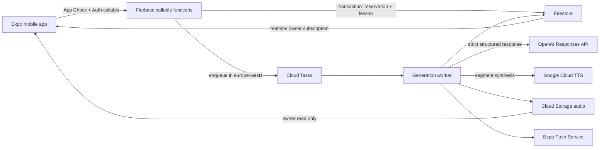

# Architecture

## Product boundary

Resolingo does one thing well: produce a daily grammar or conversation lesson appropriate to a learner's language pair and CEFR level. The topic is always selected server-side. A user may have any mix of three ready lessons per IANA-timezone day and only one active generation job.

## Generation state machine

`queued → generating_content → synthesizing_audio → ready`

Any terminal provider or validation problem produces `failed`, a user-safe failure code, releases the reservation, and clears the active job. Transient task failures retry at the queue level. The transcript is committed before TTS begins; the complete manifest is published only after every segment exists.

## Trust boundary

- The callable derives ownership from `request.auth.uid`; a UID is never accepted in request data.
- App Check is enforced on all public callables. Auth lifecycle and scheduled/task functions are not public client APIs.
- Mobile can read its profile, lessons, and audio. It may only edit allowlisted preferences and lesson completion.
- Admin SDK writes bypass rules, so the runtime service account must remain least-privileged.
- OpenAI receives a stable HMAC-derived safety identifier, not the Firebase UID.
- Telemetry is disabled in native SDKs until explicit consent.

## Data ownership

All personal data is rooted at `users/{uid}`. Lesson audio is rooted at `users/{uid}/lessons/{lessonId}` in Storage. Recursive account deletion removes both trees and then deletes the Auth identity. Ready lessons otherwise remain until deletion; failed partial objects are cleaned by schedule.
